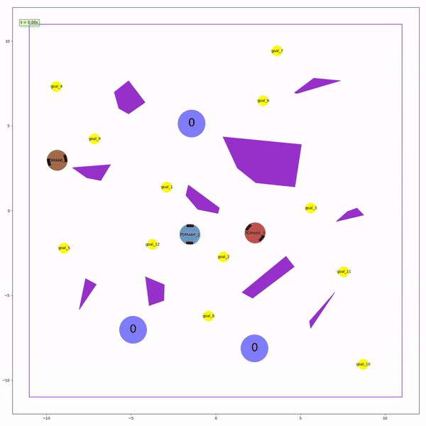

# Multi-Robot Warehouse Goal Collection

Centralized planning for a fleet of differential-drive robots that collect goals scattered across a cluttered
warehouse and deliver them to collection points. The pipeline combines a **probabilistic roadmap**,
**Adaptive Large Neighborhood Search (ALNS)** for task allocation, and **prioritized space-time planning**
that simulates the actual robot dynamics, so the planned trajectories run collision-free and open-loop.

<p align="center">
  
  <br/>
  <em>Public scenario 3: three robots collect 12 goals (yellow) and deliver them to the collection points
  (blue, with the delivered count) while avoiding the obstacles (purple) and each other.
  <a href="media/scenario3_collection.mp4">MP4 version</a></em>
</p>

## Context

This was the second final graded exercise (Exercise 14, *Multi-agent Goal Collection*) of
**Planning and Decision Making for Autonomous Robots (PDM4AR)** at ETH Zurich, taught by Prof. Emilio Frazzoli's group
(IDSC), in fall semester 2025.

- Course exercises: <https://pdm4ar.github.io/exercises/>
- Course exercise template: <https://github.com/PDM4AR/exercises>

The simulator, scenario definitions and scoring (`src/pdm4ar/exercises_def/`) come from the course template.
The global planner and agents (`src/pdm4ar/exercises/ex14/`) are our solution.

## Problem

- **Robots:** N differential-drive robots, each controlled by its wheel speeds $(\omega_l, \omega_r)$ and able to carry
  **one** goal at a time. A robot picks up a goal by driving onto it and drops it off by entering a collection
  area.
- **Map:** a bounded map with polygonal static obstacles. Robots must not collide with obstacles or with each
  other.
- **Planning:** before the episode starts, a single **global planning** call sees the whole map and broadcasts one
  message to all robots. Afterwards each robot only gets its own observations and must output commands at 10 Hz.
- **Scoring:** rewards delivered goals and a short completion time (makespan). It penalizes collisions, travelled
  distance, actuation effort and planning time.

## Approach

Everything is computed in the global planning phase. The robots then just play back their plans.

1. **Roadmap (PRM).** Halton-sampled nodes on the free space of the obstacle map, which is inflated by the robot
   radius, plus the robot starts, goals and collection points. Each node connects to its nearest collision-free
   neighbours. Shortest paths between all relevant node pairs are smoothed by greedy shortcutting, and their
   travel times account for the robot's speed and turn-in-place limits. The result is a time-based cost matrix.

2. **Task allocation (ALNS).** Assigning goals and drop-off points to robots is a multi-vehicle pickup-and-delivery
   problem; the objective is the **makespan**.
   - **Destroy operators:** random, worst, spatially clustered, and *critical*, which targets the bottleneck robot.
     Operators are picked by adaptive weights that reward success.
   - **Repair:** regret insertion with noise.
   - **Acceptance:** simulated annealing with reheating to escape local optima.
   - **Intensification:** exact or 2-opt reordering of each robot's route, and a dynamic program that picks the
     best collection point for each delivery.

   The search keeps the top-K distinct assignments rather than just the best one.

3. **Physics tournament.** Theoretical costs ignore robot–robot interaction, so the top candidates are re-planned in
   full:
   - **Prioritized space-time planning:** robots are planned one after another. Each robot's footprint is
     reserved per 0.1 s time step, and later robots must avoid those reservations.
   - **Exact dynamics:** each trajectory is generated by stepping the simulator's own differential-drive model,
     with escalating wait/backtrack strategies to resolve conflicts.
   - **Priority orders:** a "longest delivery first" heuristic plus permutations, under a time budget.
   - **Corner cutting:** at goals and collection points, waypoints are shifted inside the pickup/drop-off polygon
     to shorten the route.
   - **Selection:** the assignment/priority pair with the lowest *simulated* makespan wins. Candidates that
     cannot beat the incumbent are pruned early.

4. **Execution.** The winning trajectories, as $(x, y, \theta, t, v, \omega)$ samples, go to the robots in the
   global plan message. Each robot converts the planned $(v, \omega)$ to wheel speeds at every step. The plan was
   produced with the exact simulator model, so open-loop playback reproduces it.

## Results (public scenarios)

| Scenario | Robots | Goals delivered | Collisions | Completion time [s] | Score |
|---|--:|--:|:-:|--:|--:|
| 1 | 1 | 5 / 5 | 0 | 33.2 | 732.9 |
| 2 | 4 | 6 / 6 | 0 | 13.8 | 1006.4 |
| 3 | 3 | 12 / 12 | 0 | 22.2 | 1505.3 |

Global planning takes 20–40 s per scenario on a laptop, most of it in the time-budgeted ALNS search and
tournament.

The allocation search and the tournament run under wall-clock budgets, so results can vary slightly between machines.

## Running it

Requirements: Linux x86_64 (the prebuilt `commonroad-drivability-checker` wheel used by the simulator is
Linux-only), Python 3.11, [uv](https://docs.astral.sh/uv/), and `ffmpeg` for the animations.

```bash
uv venv -p 3.11
uv pip install -e .

# all public scenarios
.venv/bin/warehouse-mapf

# a single scenario
.venv/bin/warehouse-mapf -c config_3.yaml
```

The HTML report, with the animation and metrics, is written to `out/14/index.html`. A convergence plot of the
allocation search goes to `out/ex14/debug_plots/`.

## Repository layout

```
src/pdm4ar/
├── main.py                        # entry point: runs scenarios, writes the report
├── exercises/ex14/                # ← solution
│   ├── agent.py                   #   global planner (PRM, routing, tournament) + robot agent
│   ├── task_allocator.py          #   makespan evaluation and ALNS task allocation
│   ├── exact_spacetime_planner.py #   prioritized space-time planning with the exact robot model
│   └── planner_viz.py             #   convergence/debug plots
└── exercises_def/ex14/            # course-provided simulator setup, scenarios (YAML) and metrics
```

## Credits & license

Built together by the three of us (Tobias Tichy, S. Ramchandani, Max Firkowski; team *temu-warehoes*).
The exercise framework, simulator ([dg-commons](https://github.com/idsc-frazzoli/dg-commons)) and scenarios are by the
PDM4AR teaching team at IDSC, ETH Zurich. Licensed under GPL-3.0, inherited from the course template.
